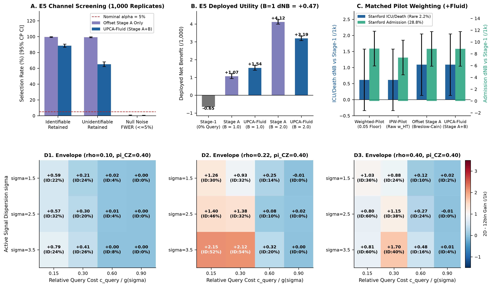
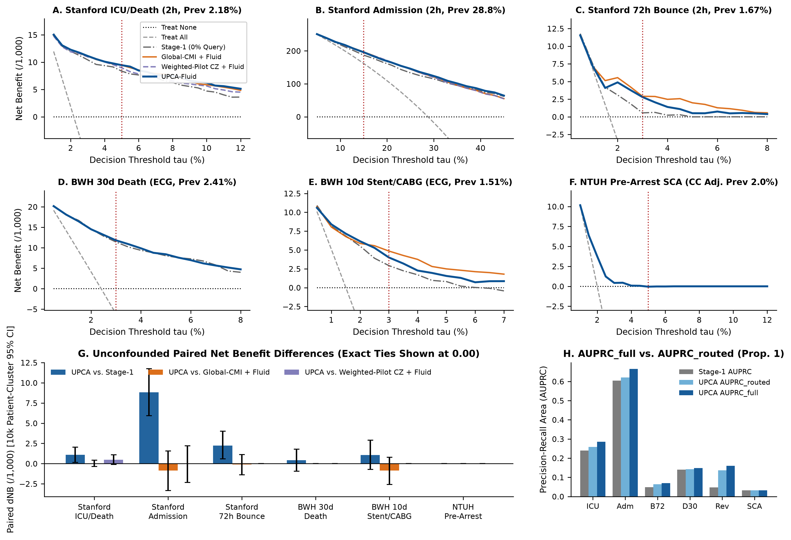
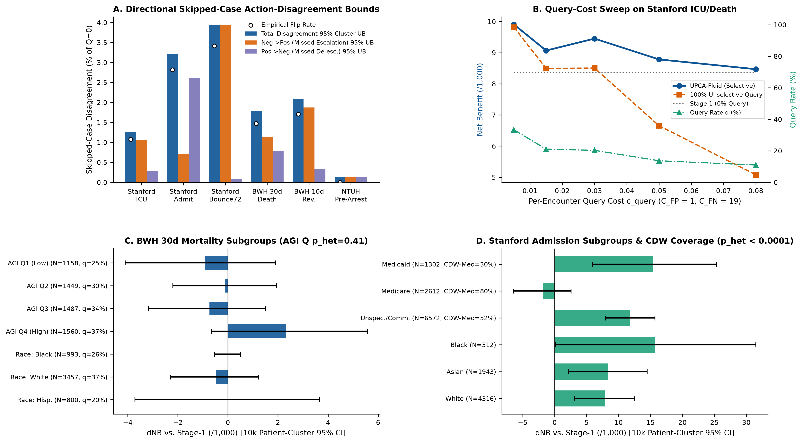
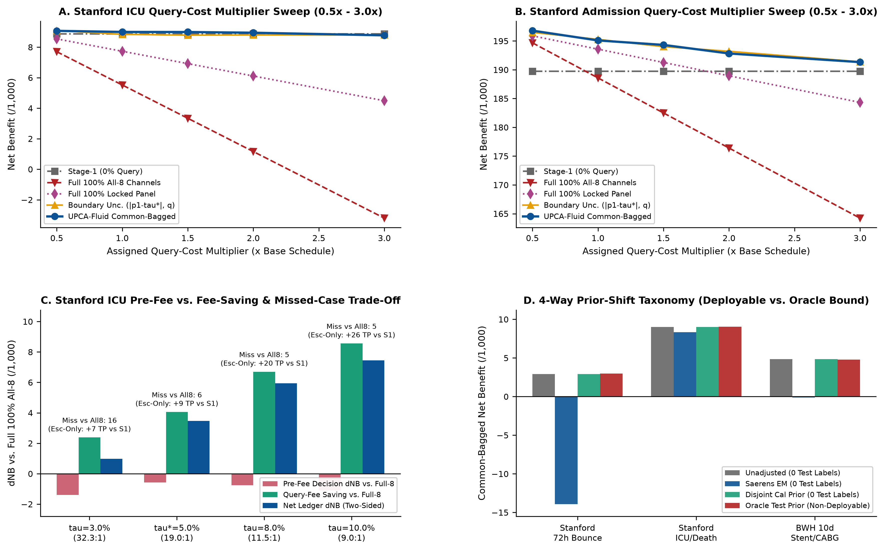

# `DecisionAwareAcquisition` (`v2.2.0` — Audited Channel-Scheduled UPCA-Fluid Suite)

[](tests/)
[](https://github.com/deesatzed/DecisionAwareAcquisition/releases/tag/v2.2.0)
[](LICENSE)

**Decision-Aware Clinical Feature Acquisition with Two-Phase Sampling and Pre-Purchase Policy Screening**

**Author:** Wayne A. Satz, MD (Department of Emergency Medicine, Lewis Katz School of Medicine at Temple University; `satzwa@temple.edu`)

- **Public GitHub Release (`v2.2.0`, Computational Code Commit `9ac6de0`):** [https://github.com/deesatzed/DecisionAwareAcquisition/releases/tag/v2.2.0](https://github.com/deesatzed/DecisionAwareAcquisition/releases/tag/v2.2.0)
- **Manuscript PDF (`0` TeX warnings, Pass-1 audited unsealed draft):** [`manuscript/main.pdf`](manuscript/main.pdf)
- **Preprint Archival:** Prepared for **Preprints.org** Crossref DOI archival (`CITATION.cff`, `LICENSE`, `SEED_MANIFEST.md`, `requirements-lock.txt`).
- **Companion Trilogy Releases:**
  - Paper 1 (`imboreceipt` `v2.2.1`, Preprints.org `10.20944/preprints202611.2517.v1`): [https://github.com/deesatzed/imboreceipt/releases/tag/v2.2.1](https://github.com/deesatzed/imboreceipt/releases/tag/v2.2.1)
  - Paper 2 (`collision-zone-ed` `v2.3.1`, upstream constants commit `8c8c4c8`): [https://github.com/deesatzed/collision-zone-ed/releases/tag/v2.3.1](https://github.com/deesatzed/collision-zone-ed/releases/tag/v2.3.1)

---

## Overview (`v2.2.0`)

`DecisionAwareAcquisition` (`v2.2.0`, computational commit `9ac6de0`) is a 100% standalone open-source package formulating and auditing **Unified Policy-Guided Clinical Acquisition (`UPCA-Fluid`)** across **`4,600` synthetic runs** and **`157,324` unique leak-free emergency encounters** (`89,395` Stanford `MC-MED >2.0h` [`51,736` discharged subset], `51,158` BWH `ED-ECG`, and `16,771` NTUH `Pre-Arrest SCA`, plus `818` supplementary `[1]ROSC` traces):

1. **Breslow–Cain Offset Two-Phase Pilots & Disjoint `50/50` Split-Pilot Confirmation** (`Propositions 1 & 4`, `Assumption 1`): Unifies mode-aligned Beta proper scoring (`Schervish, 1989`; `Buja, Stuetzle & Shen, 2005`) with Boltzmann-KL gating (`< 3e-15` identity error) and linear-weight Horvitz–Thompson variance (`s^2/n` SRS error `2.7e-20`). Across `500` repeated `20%` pilots on Stanford `2h` ICU/mortality, unweighted offset GBDTs lift top-1 oracle concordance from `73.8%` (`Weighted-CZ`) and `67.6%` (`IPW`) to **`87.4%` (`p = 4.70e-12`; `34.5%` parametric slope variance cut vs. IPW)**, while `200`-pilot and `400`-rep `E5` audits quantify the exact sample-halving power cost of disjoint `50/50` split-pilot confirmation (`61.0%` vs. `82.0%` top-1; `1.0%–1.5%` null FWER).
2. **Scheduled Pre-Purchase Policy Screening & 4D Operating Envelope** (`Proposition 5`): Screens Stage-A candidates via `12 x 2` dispersion-stratified martingale VOI ($z_{0.90}=1.282$) under an explicit encounter-plus-channel cost schedule (`ChannelCostSchedule`), holding `1,000`-rep null FWER at `0.10%` and lifting tight-budget ($B=1$) Net Benefit by `+0.47/1,000` (`p = 1.4e-11`), while mapping flat vs. scheduled $B=2.0$ bundling (`-0.92` vs. `-0.66`) and `72`-cell (`3,600`-run) finite-sample breakdown boundaries.
3. **Deployable `Common-Panel Bagged VOI` (`R = 10`), `0.5x–3.0x` Fee Sweeps, Missed-Case / `Escalation-Only VOI` Ledger, 4-Way Prior-Shift Taxonomy, & `36` Cochran's $Q$ Subgroup Audits**: Locks one deployable order set per task (`Common-Panel Bagged VOI`), beating `Full 100%` Stage-2 querying on Stanford ICU (`+3.48/1,000, p = 0.0002`), Inpatient Admission (`+6.51, p = 0.0002`), and NTUH Pre-Arrest (`+1.58, p = 0.0208`) conditional on assigned fees; exceeding the `1.0/1,000` post-hoc reference `MCID` vs. zero-query Stage-1 on Admission (`+5.35, p = 0.0008`) and BWH `10d` Revascularization (`+1.71, p = 0.0182`) while remaining inconclusive on Stanford ICU (`+0.12, p = 0.758`); pairing two-sided VOI (`5–16` missed ICU cases vs. `Full 100% All-8`) with **`Escalation-Only VOI` (`0` missed baseline Stage-1 cases, `+7` to `+26` extra TPs)**; contrasting zero-test-label calibration against unlabeled `Saerens EM` and the non-deployable Oracle $\pi_{\text{test}}$ bound; and reporting all `5` post-hoc nominal $p_{\text{het}} < 0.05$ subgroup flags across `36` Cochran's $Q$ tests.










---

## Standalone Installation, `< 1s` Ledger Verifier & `48/48` Unit Tests

```bash
git clone https://github.com/deesatzed/DecisionAwareAcquisition.git
cd DecisionAwareAcquisition
python3.12 -m venv .venv
source .venv/bin/activate
pip install -r requirements-lock.txt
pip install -e ".[dev]"

# 1. Verify all 279 algebraic table, cost-schedule, missed-case & prior-shift invariants (< 1s)
python scripts/verify_paper3_v2_2_tables.py

# 2. Run full standalone automated test suite (48/48 passing, 0 ruff errors)
pytest -q
```

### Repository Layout

- `src/decision_aware_acq/` & `src/collision_zone/` — Standalone statistical library: `upca_v2_core.py`, `upca_v2_2_repairs.py` (`ChannelCostSchedule`, `discover_stage_a_split_pilot`, `oof_policy_screening_stage_b_scheduled`, `evaluate_dual_afa_scheduled`, `compute_fluid_specialist_diagnostics`, `directional_voi_masks`, `saerens_em_prevalence_estimate`, `cochran_q_subgroup_heterogeneity`, `xor_finite_capacity_counterexample`), and bundled `collision_zone` primitives.
- `scripts/build_audited_cohorts_v2.py` — Strict leak-free cohort builders (`Dispo_time > 2.0h`, `Result_time <= 2.0h`, `Noted_date / Entry_date < Arrival_time`, non-incorporated arrival-ECG BWH, and Prentice–Pyke case-control NTUH `[0]pre` vs. `control-group`).
- `scripts/run_paper3_v2_2_remediation.py` — Modular 4-block execution pipeline (`--block 1`, `--block 2`, `--block 3`, `--block 4`, `--block merge`).
- `scripts/verify_paper3_v2_2_tables.py` — Deterministic `< 1s` checkpoint-to-table algebraic verifier (`279` verified checks).
- `scripts/plot_paper3_v2_2_figures.py` — Generates all `5` `300-DPI` publication figures (`fig1`–`fig5`).
- `SEED_MANIFEST.md`, `requirements-lock.txt`, `CITATION.cff`, `LICENSE` — Complete deterministic RNG seed & provenance ledger and pinned Python 3.12 environment (`LightGBM 4.7.0`, `scikit-learn 1.9.1`, `SciPy 1.18.1`).
- `tests/` — Standalone `pytest` verification suite (`test_policy_admission.py`, `test_upca_v2.py`, `test_upca_v2_2_repairs.py`, `test_paper3_v2_2_table_verifier.py`; `48/48` passing).
- `results/` — Machine-readable `cohort_provenance_and_flow_audit.json`, `paper3_v2_2_remediation_results.json`, `v2_2_blocks/block1..4.json`, and `fig1..5.png`.
- `manuscript/` — Self-contained `main.tex` (`v2.2.0`, `< 200`-word Abstract, Appendices A–E including `v2.2.0` Revision Ledger and `tripod_ai_checklist.tex`), `references.bib`, `main.pdf`, and `300-DPI` figures.

### De-Identified Clinical Data Access (Zero Patient Records in Repo)
No patient-level clinical records are committed to this repository. Underlying de-identified datasets are accessible to credentialed researchers via **Nightingale Open Science** (`https://ngsci.org`; `ed-bwh-ecg`, `arrest-ntuh-ecg`, `mcmed-stanford-multi`) and **PhysioNet** (`https://physionet.org`; `mcmed-stanford-multi`).

---

## Acknowledgments & Clinical Governance

Computational and agentic research platform access was supported in part by the **Google Antigravity for Science** program. Portions of the computational workflow—literature verification, Python pipeline engineering, statistical verification scripts, and manuscript editing—were conducted using *Google Antigravity* powered by *Gemini 3.1 Pro* in accordance with COPE guidelines (zero generative fabrication or alteration of primary clinical or empirical data). All study design decisions, mathematical proofs, empirical code executions, bibliographic citations, clinical interpretations, and final text were independently reviewed, verified, and approved by the human author, who takes full responsibility for the integrity and accuracy of this work. All results represent retrospective *in-silico* methodological evaluations and are not cleared or validated for clinical patient care.
