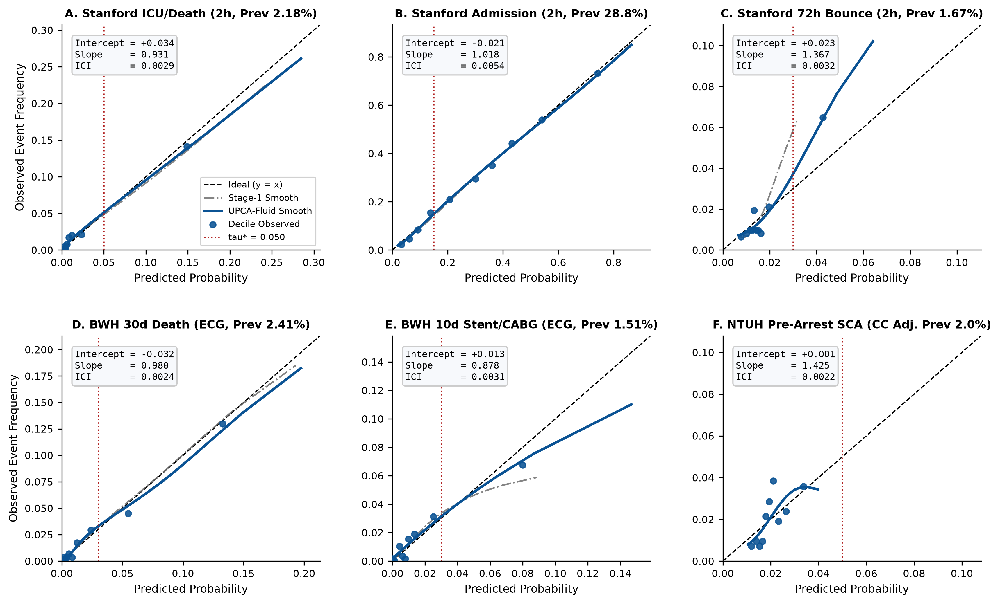

# `decision-aware-acquisition` (v2 — Audited Leak-Free UPCA-Fluid Suite)

**Decision-Aware Clinical Feature Acquisition with Two-Phase Sampling and Pre-Purchase Policy Screening**

**Author:** Wayne A. Satz, MD (Department of Emergency Medicine, Lewis Katz School of Medicine at Temple University; `satzwa@temple.edu`)

- **Manuscript PDF (`21` pages, `0` warnings):** [`manuscript/main.pdf`](manuscript/main.pdf) (Sealed Pass-2 Merkle SHA-256: `4bb67e99488e0bb34d11add45d434db8a2eab7b8ec9a45f07b133bb08cd73b14`, Seal ID: `4839d69eebdab6d1646590af`)
- **Compliance Certificate:** [`SUBMISSION_COMPLIANCE_CERTIFICATE.md`](SUBMISSION_COMPLIANCE_CERTIFICATE.md)
- **Companion Backbone Package (`collision-zone-ed`):** [https://github.com/deesatzed/collision-zone-ed](https://github.com/deesatzed/collision-zone-ed)

---

## Overview

`decision-aware-acquisition` formulates and audits **Unified Policy-Guided Clinical Acquisition (`UPCA-Fluid`)**, a prespecified statistical pipeline with zero dataset-specific hyperparameter tuning combining:
1. **Breslow–Cain Case–Control Log-Odds Offset Two-Phase Pilots** (`Proposition 3`): Eliminates both `0.05`-floor leaf starvation on rare multi-channel endpoints (`88%` vs. `72%` repeated-pilot top-1 oracle concordance; `36.4%` parametric variance reduction over IPW) and raw Horvitz–Thompson split-gain inflation on common outcomes, while acting as a transparent tie where pilot weighting leaves channel selection invariant.
2. **Nested OOF Pre-Purchase Policy Screening** (`Proposition 4`): Screens Stage-A channels using out-of-sample `12 x 2` dispersion-stratified empirical martingale VOI ($z_{0.90}=1.282$), benchmarked across **`1,000` synthetic replicates** (`0.10%` null FWER `[0.003%, 0.56%]`, `+0.47` NB/1k at $B=1.0$, $p = 1.4 \times 10^{-11}$) and a **`72`-cell (`3,600`-run) 4D operating-envelope grid**.
3. **Directional Patient-Cluster Skipped-Case Action-Disagreement & Risk-Difference Bounds** (`Propositions 1–2`), paired with unconfounded `FluidCollisionBackboneClassifier` ablations, `10,000`-replicate patient-cluster Davison–Hinkley bootstraps, flexible spline calibration curves (`ICI 0.0022–0.0054`), and Vickers Decision Curves across **`157,324` leak-free primary encounters** (`Stanford MC-MED 2.0h`, `BWH ED-ECG`, and `NTUH Pre-Arrest SCA` + `818` supplementary `[1]ROSC` traces).





---

## Installation & Reproducibility (`8/8` Unit Tests Passing)

```bash
git clone https://github.com/deesatzed/decision-aware-acquisition.git
cd decision-aware-acquisition
python3 -m venv .venv
source .venv/bin/activate
pip install "git+https://github.com/deesatzed/collision-zone-ed.git"
pip install -e ".[dev]"

# Run full automated test suite (8/8 passing)
pytest -q
```

### Repository Layout

- `src/decision_aware_acq/` & `src/upca_v2_core.py` — Case-control prevalence adjustment, covariance-adjusted Mahalanobis within-stratum independence check, directional patient-cluster disagreement bounds, spline `ICI`/calibration, Cochran $Q$ heterogeneity, and `10,000`-rep patient-cluster ratio bootstrap.
- `scripts/build_audited_cohorts_v2.py` — Strict leak-free cohort builders (`Dispo_time > 2.0h`, `Result_time <= 2.0h`, `Noted_date / Entry_date < Arrival_time`, non-incorporated ECG-access vs. complete-troponin BWH, and Prentice–Pyke case-control NTUH `[0]pre` vs. `control-group`).
- `scripts/run_paper3_v2_remediation.py` — Full unconfounded benchmark, ablation, sensitivity, and `3,600`-run operating-envelope suite.
- `scripts/plot_paper3_v2_figures.py` — Generates `Figures 1–4` (`300 DPI`).
- `tests/` — Automated `pytest` verification suite (`test_policy_admission.py` and `test_upca_v2.py`; `8/8` passing).
- `results/` — Machine-readable `cohort_provenance_and_flow_audit.json` and `paper3_v2_remediation_results.json`.
- `manuscript/` — Self-contained `main.tex`, `references.bib` (`35/35` cited keys), `main.pdf`, and `Figures 1–4`.

### De-Identified Clinical Data Access (Zero Patient Records in Repo)
No patient-level clinical records are committed to this repository. Underlying de-identified datasets are accessible to credentialed researchers via **Nightingale Open Science** (`https://ngsci.org`; `ed-bwh-ecg`, `arrest-ntuh-ecg`, `mcmed-stanford-multi`) and **PhysioNet** (`https://physionet.org`; `mcmed-stanford-multi`).

---

## Acknowledgments & Clinical Governance

Computational and agentic research platform access was supported in part by the **Google Antigravity for Science** program. Portions of the computational workflow—literature search, Python pipeline engineering, numerical formula verification, and manuscript drafting—were conducted using *Google Antigravity* powered by *Gemini Pro* models in accordance with COPE guidelines (zero generative fabrication or alteration of primary clinical or empirical data). All study design decisions, mathematical proofs, empirical code executions, bibliographic citations, clinical interpretations, and final text were independently reviewed, verified, and approved by the human author, who takes full responsibility for the integrity and accuracy of this work.
